  

  
  
  

<table>
<tr>
<td valign="middle" width="50%">

Backend developer building reliable APIs and data-driven systems, now diving into AI and Deep Learning. Outside of code, I’m fascinated by physics and engineering.

</td>
<td valign="middle" width="50%" align="center">

</td>
</tr>

<tr>
<td valign="top" colspan="2">

<b>Technologies/Tools</b>
  

  

</td>
</tr>
</table>

  
  

